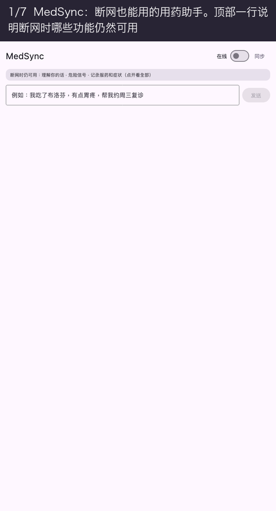
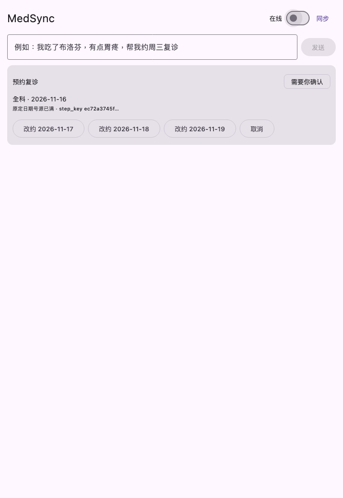
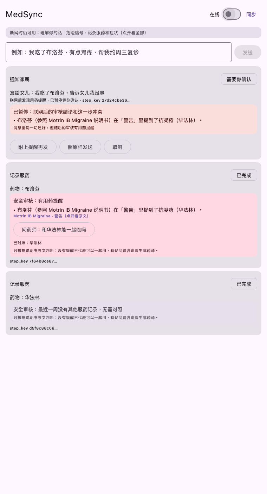
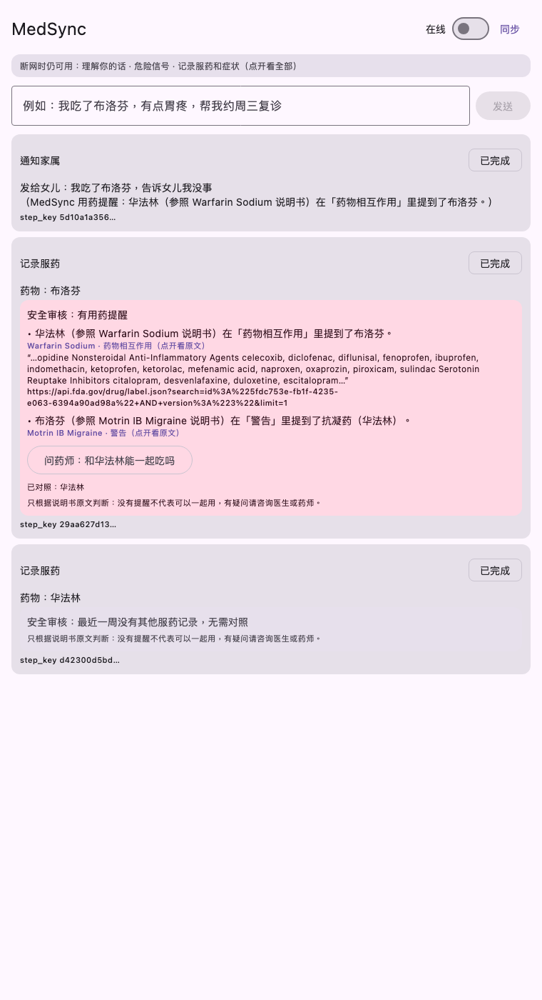
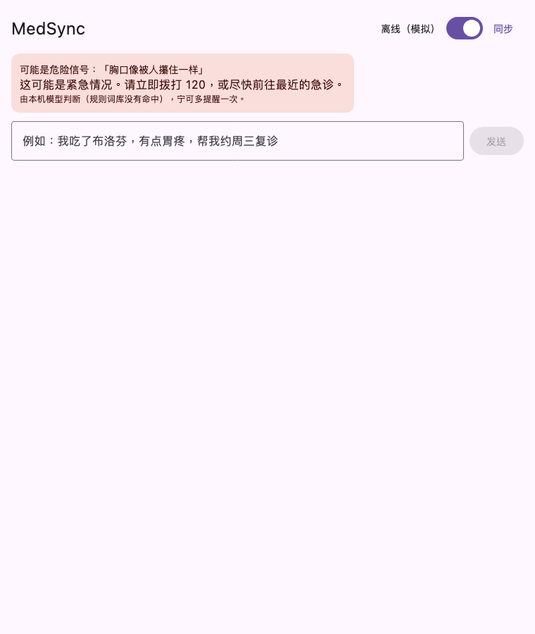

# MedSync

弱网环境下端云协同的用药管理多智能体系统。客户端是一套 Kotlin Multiplatform 代码，覆盖 **Android、iOS 和桌面（macOS / Windows / Linux）**。

核心问题：Agent 有副作用的操作，在**断网、超时、重试、进程被杀、LLM 重新推理**时，要做到端到端**只执行一次**；排队期间情况变了的动作，要能被拦下来。



```sh
scripts/up.sh --model --app   # 启动全部服务 → 冒烟测试 → 准备端侧模型 → 打开桌面端
```

右边的动图是 [2 分钟演示](docs/demo.md) 的故事，由 `DemoTest` 在真实的 App 和服务上自动跑出来：
1. 断网时，本机模型识别出关键词规则漏掉的危险信号。
2. 本机模型把一句话拆成 3 个动作，存进本机队列。
3. 联网后，安全审核的结论和排队的"我没事"矛盾，这条消息被暂停；号源被抢，问用户改约哪天。
4. 用户确认后，每个动作只执行一次，以外部系统自己统计的次数为准。

架构详见 [docs/architecture.md](docs/architecture.md)，关键决定的理由见 [docs/adr/](docs/adr/)。

<br clear="right">

```
客户端 (Android / iOS / 桌面，KMP 共享代码)
  路由 Agent · 危险信号 Agent · Room outbox（step_key 在规划时生成并落库）
        │ ① Toxiproxy :18081
        ▼
gateway (Spring Boot + MyBatis + MySQL + Redis)        action_ledger：同 key 同内容→重放，同 key 不同内容→409
        │ ② Toxiproxy :18000
        ▼
agent (FastAPI + LangGraph + Postgres)                 一个 step = 一个 LangGraph 线程；revalidate → executor（MCP 客户端）
        │ MCP · Toxiproxy :19200                       可选：Langfuse，每个 plan 一条 trace
        ▼
tools (MCP Server，streamable HTTP)                    tool_ledger：INTENT → COMMITTED，结果不明时先按 step_key 查
        │ ③ Toxiproxy :19000
        ▼
mocks (模拟医院预约 / 家属通知)                         故意不去重；/metrics/side_effects 是评测的唯一依据
```

## 目录

| 目录 | 内容 |
|---|---|
| [client/](client/) | KMP 客户端：`shared`（业务逻辑 + Compose UI）、`androidApp`、`iosApp`、`desktopApp` |
| [services/gateway/](services/gateway/) | 同步网关，在 MedTrack sync-server 基础上新增 `action_ledger` 和 `/v1/actions` |
| [services/agent/](services/agent/) | Agent 服务（LangGraph 图、Langfuse 追踪）和 MCP 工具服务（tool ledger），同一个镜像 |
| [services/mocks/](services/mocks/) | 模拟外部系统，带副作用计数和"提交后响应丢失"故障 |
| [services/rag/](services/rag/) | 从 MedTrack 拷贝的说明书 RAG + Gemini 问答 Agent，供药学问答步骤调用 |
| [chaos/](chaos/) | Toxiproxy 三跳配置和故障注入脚本 |
| [scripts/smoke.py](scripts/smoke.py) | 端到端冒烟测试 |
| [eval/](eval/) | 对比实验：B0 朴素重试 / B1 请求级幂等 / B2 参数哈希去重 / Full，报告见 [eval/report.md](eval/report.md) |
| [docs/architecture.md](docs/architecture.md) | 架构：组件、一个动作的一生、三跳去重、多 Agent 协作、离线降级 |
| [docs/adr/](docs/adr/) | 8 篇架构决定记录 |
| [docs/demo.md](docs/demo.md) | 2 分钟演示的分镜和讲解 |
| [docs/开发计划.md](docs/开发计划.md) | 分阶段开发计划 |

## 启动服务端

```sh
scripts/up.sh                 # 没有 .env 时用随机密码生成一个 → docker compose up --wait → 冒烟测试
```

`.env` 里的 `GEMINI_API_KEY` 默认是空的，这时用药问答会显示"药学服务未配置"，其他功能都正常。也可以手动启动：

```sh
cp .env.example .env          # 填三个数据库密码和 MEDSYNC_INTERNAL_SECRET；要回答用药问题再填 GEMINI_API_KEY
docker compose up --build -d --wait
python3 scripts/smoke.py      # 14 项检查：重放、409、响应丢失、Agent 不可达、号源被抢、安全审核、MCP 连接断开和丢响应、跨 Agent 冲突、无重复副作用
```

| 地址 | 用途 |
|---|---|
| `127.0.0.1:18081` | 客户端入口（经过 Toxiproxy 第①跳）。Android 模拟器用 `10.0.2.2:18081` |
| `127.0.0.1:8474` | Toxiproxy 控制 API，`python3 chaos/toxic.py list` |
| `127.0.0.1:9100` | mocks，直连无故障，评测用来读真实副作用 |
| `127.0.0.1:8091` / `8100` / `8200` | gateway / agent / MCP 工具服务（`/mcp`）直连，仅调试 |
| `127.0.0.1:3000` | Langfuse（只在 `scripts/up.sh --langfuse` 时启动） |

端口避开了 MedTrack（8081、8765），两套可以同时运行。

### 故障注入

```sh
python3 chaos/toxic.py down gateway_agent          # 第②跳断开
python3 chaos/toxic.py latency device_gateway 3000 # 第①跳慢网
python3 chaos/toxic.py reset agent_external        # 第③跳连接被重置
python3 chaos/toxic.py down agent_tools            # agent → MCP 工具服务断开
python3 chaos/toxic.py clear
# "医院已提交、响应丢失"：Toxiproxy 无法只针对单个接口，所以这个故障由 mocks 提供
curl -X POST 127.0.0.1:9100/admin/faults -H 'Content-Type: application/json' \
     -d '{"path": "/hospital/bookings", "delay_s": 8}'
```

### 工具走 MCP，追踪用 Langfuse

agent 的 executor 不直接调用外部系统，而是通过 MCP 客户端调用 `tools` 服务。只执行一次的保证放在工具服务里：它独占 tool_ledger，所以任何 MCP 客户端（这个 agent、别的 LLM planner、Claude）只要带上同一个 step_key，都不会重复预约或重复发消息。MCP 回复丢了，也按"结果未知、用同一个 step_key 重试"处理，冒烟测试里有这一项（[ADR 0009](docs/adr/0009-mcp-tool-server-owns-exactly-once.md)）。

```sh
scripts/up.sh --langfuse      # 另外自托管一套 Langfuse，界面在 http://localhost:3000，账号和密码在 .env 里
python3 scripts/langfuse_check.py   # 发一个两步的 plan，检查它在 Langfuse 里是一条 trace、含节点和 MCP 调用、没有自由文本
```

每个 plan 一条 trace：同一句话拆出的几个步骤，哪怕隔了几个小时才陆续执行，也在同一条 trace 里，下面是 LangGraph 的每个节点和每次 MCP 调用。用户写的消息、备注、提问只记录长度，账户 id 做哈希。

## 对比实验

640 个故障注入回合，以模拟外部系统记录的实际副作用次数为准：

| | B0 朴素重试 | B1 请求级幂等 | B2 参数哈希去重 | **Full** |
|---|---|---|---|---|
| 重复副作用率 IVR | 50% | 33% | 33% | **0%** |
| 过期 / 契约变更的动作被执行 | 20/20 | 20/20 | 20/20 | **0/20** |

完整结果、消融实验和局限见 [eval/report.md](eval/report.md)，复现：

```sh
docker compose -f docker-compose.yml -f eval/compose.experiment.yml up -d --build
python3 eval/run_experiment.py --reps 10
uv run --with matplotlib python eval/report.py
```

## 运行客户端

需要 JDK 21。

```sh
cd client
./gradlew :desktopApp:run                 # 桌面端（macOS / Windows / Linux）
./gradlew :androidApp:installDebug        # Android（先启动模拟器）
./gradlew :desktopApp:packageDistributionForCurrentOS   # 打包 .dmg / .msi / .deb
./gradlew :shared:jvmTest                 # 共享逻辑的单元测试
```

**iOS**：需要完整的 Xcode（只有 Command Line Tools 不够）。用 Xcode 打开 `client/iosApp/iosApp.xcodeproj` 运行即可，构建时会自动调用 Gradle 编译 `shared` 框架。真机运行需要在 `client/iosApp/Configuration/Config.xcconfig` 里填 `TEAM_ID`。

**用药问答**：例如输入"布洛芬能和阿司匹林一起吃吗？"。在线时，这个问题由 `services/rag` 检索 openFDA 说明书后回答，答案里的 [S1] 会高亮，点开能看到原文摘录。找不到可引用的原文时会直接拒答。

问到"我吃的药"时，药学 Agent 会读取你记录过的服药（最近 90 天）。它拿到的是网关临时签发的只读授权：有效期 2 分钟，只能读用药清单，不会被保存下来。

同一个药名可能对应多个产品，这时会先反问是哪一款，并把候选产品列成按钮（标明厂商和版本）；点一下就会接着回答，也可以直接回复产品名。10 分钟内的追问（例如"它一天最多吃几片？"）也会接着同一段对话。没有配置 `GEMINI_API_KEY` 时，这一步会失败并显示"药学服务未配置"。

**安全审核**：每条服药记录同步到服务器时，会和你最近一周记录过的其他药对照一遍（例如先记了"华法林"，再记"布洛芬"）。依据只有 openFDA 说明书原文，不调用大模型：一种药的说明书在"禁用 / 用药前咨询医生或药师 / 药物相互作用 / 警告"里提到另一种药的成分或类别（如"blood thinning (anticoagulant)"），或者两种产品 24 小时内含有相同成分（如两种都含对乙酰氨基酚），就在这条记录下方提醒，点开能看到引用的原文，还可以一键转给药学 Agent 追问。药已经吃了，所以只提醒、不拦截；认不出的药名会列为"未检查"，没有提醒也不代表可以一起吃。审核服务暂时连不上时，这条记录会在服务器排队，恢复后补做审核，不会跳过。评测见 [services/rag/eval/safety/REPORT.md](services/rag/eval/safety/REPORT.md)。

**跨 Agent 冲突检测**：离线时手机按当时的理解排好了动作，例如"吃了对乙酰氨基酚，告诉女儿我没事"会生成一条服药记录和一条待发消息。联网后，安全审核（以及药学问答里查到的说明书相互作用提醒）会把结论写到服务器的"发现板"上；不可逆的动作执行前，先查有没有排队时还不知道的结论和它矛盾。规则很少，写在 `services/agent/medsync_agent/conflicts.py`：

| 排队的动作 | 后来的结论 | 处理 |
| --- | --- | --- |
| 通知家属 | 高风险提醒 | 暂停，问你：附上提醒再发 / 照原样发 / 取消 |
| 通知家属 | 一般提醒，且消息里说"没事""放心"等 | 暂停，同上 |
| 通知家属 | 一般提醒，消息内容中性 | 照常发送 |
| 预约复诊 | 任何提醒 | 照常预约（去看医生和提醒并不矛盾） |

暂停期间什么都不会发出去；"附上提醒再发"追加的文字由服务器根据审核结果生成，不采用手机传回的内容。为了让审核结果先到，同一句话里的通知会等服务器处理完那条服药记录再发送。

下面三张截图来自桌面端界面走查（`WalkthroughTest`，无界面运行真实的 App，连着本机的 Compose 服务）：离线约的号被抢后改约；联网后服药记录出现提醒，排队的"我没事"被暂停；附上提醒后发出。

<p>



</p>

**端侧路由**：桌面端如果在 `~/.medsync/models/` 里找到 Qwen3-0.6B（LiteRT-LM 格式，328 MB），就用它在本机理解用户的话，不需要联网；模型不可用、超时或出错时自动退回规则路由。在 210 句中文评测集的 test 部分，整句完全正确率 87%（规则 48%），在 Apple M4 Pro 的 CPU 上每句 p50 约 2 秒。方法、结果和局限见 [eval/routing/README.md](eval/routing/README.md)。没有在 Android 真机上测过。

**危险信号**：规则词库先判断，命中就立刻提醒；规则没命中时，再让同一个端侧模型判断一次。模型只能增加提醒，而且必须照抄用户原话里说明危险的那几个字作为依据，找不到就不提醒。在 127 句评测集的 test 部分，召回率从规则的 31% 提高到 92%，代价是误报率从 23% 升到 36%。详见 [eval/redflag/README.md](eval/redflag/README.md)。



界面右上角的开关可以**模拟离线**。标题下面有一块面板，标出每项功能在断网时的情况，离线时自动展开：

| 状态 | 功能 |
|---|---|
| 离线可用 | 理解你的话、危险信号、记录服药和症状 |
| 联网后执行 | 预约复诊、通知家属、相互作用检查 |
| 需要联网 | 用药问答（离线时没有说明书依据，所以不回答） |

`CapabilitiesTest` 会在离线状态下逐项检查，确保面板上的标签和 App 的实际行为一致。

## 测试

```sh
cd services/gateway && ./mvnw -q -Dtest='ActionLedgerTest,RedisFallbackTest,DelegationTest,AgentClientTest' test   # 20 项
cd services/agent   && uv run pytest -q                                            # 60 项（含 MCP 6 项、Langfuse 追踪 3 项）
cd services/rag     && .venv/bin/python -B -m unittest test_safety_review test_agent test_label_api test_medtrack   # 60 项
cd services/rag     && .venv/bin/python -B evaluate_safety.py                      # 相互作用提醒评测，32 个用例
cd services/mocks   && uv run pytest -q                                            # 4 项
cd client           && ./gradlew :shared:jvmTest :desktopApp:test                  # 共享逻辑 34 项 + 离线能力标签 1 项
python3 scripts/smoke.py                                                           # 端到端，需要 Compose 在运行
cd client && MEDSYNC_LIVE=1 ./gradlew :shared:jvmTest   # 再加 2 项：真实 Ktor 客户端 → 三跳 → mocks / RAG
cd client && MEDSYNC_WALKTHROUGH=1 ./gradlew --no-configuration-cache :desktopApp:test --tests '*WalkthroughTest*'   # 桌面端界面走查，截图存到 desktopApp/build/walkthrough
cd client && MEDSYNC_ROUTING_EVAL=1 ./gradlew --no-configuration-cache :desktopApp:test --tests '*RoutingEvalTest*' && python3 ../eval/routing/score.py   # 端侧路由评测
cd client && MEDSYNC_DEMO=1 ./gradlew --no-configuration-cache :desktopApp:test --tests '*DemoTest*' && uv run --with pillow python ../scripts/demo_gif.py   # 演示动图
cd client && MEDSYNC_REDFLAG_EVAL=1 ./gradlew --no-configuration-cache :desktopApp:test --tests '*RedFlagEvalTest*' && python3 ../eval/redflag/score.py   # 危险信号评测
```

## 来源

- `services/gateway`、`services/rag` 拷贝自 MedTrack，网关的包名改成了 `com.medsync.gateway`。
- `client/` 基于 JetBrains 官方 [Kotlin/KMP-App-Template](https://github.com/Kotlin/KMP-App-Template)（Apache 2.0，见 `client/LICENSE`），去掉了 Web 端和示例代码。
