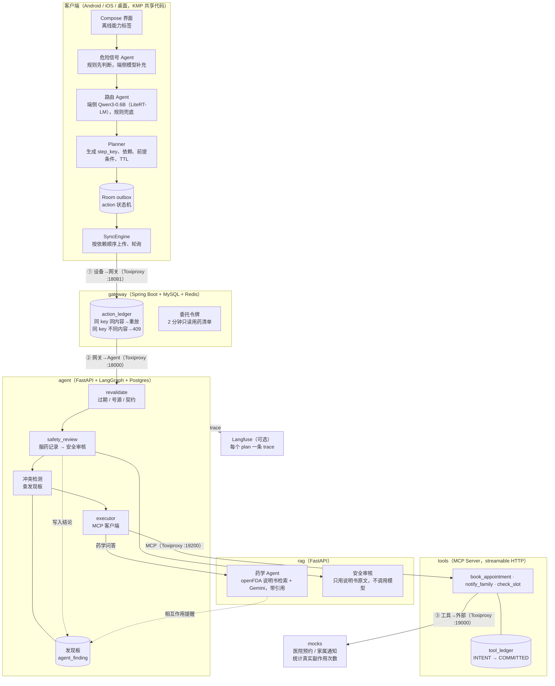
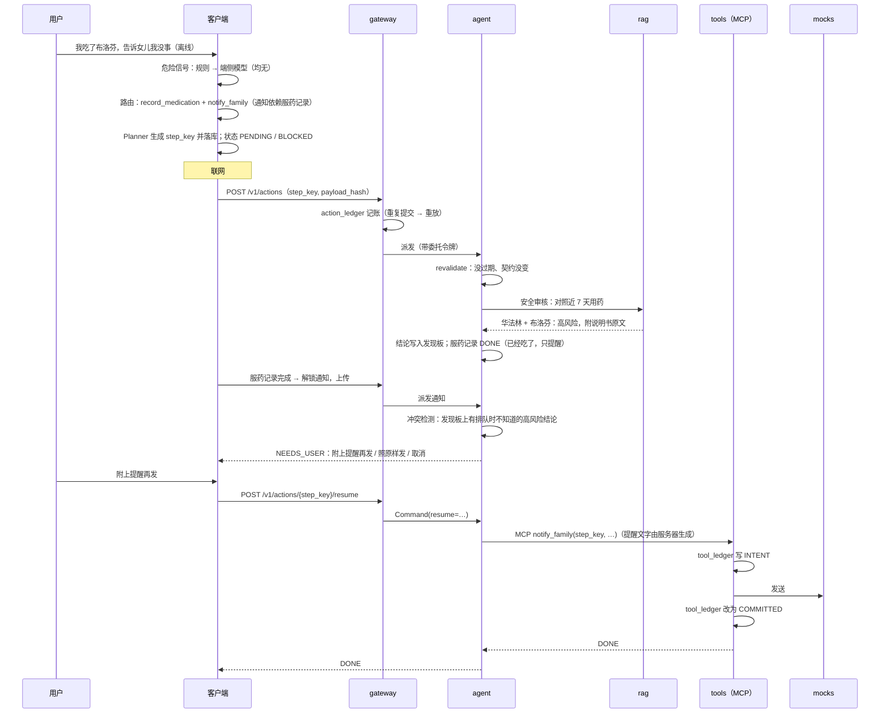

# MedSync 架构

MedSync 是一个用药管理助手，要在网络不稳定时也能用。它要解决的问题只有一个：**Agent 有副作用的操作（预约、发消息），在断网、超时、重试、进程被杀、LLM 重新推理时，端到端只执行一次；排队期间情况变了的动作，执行前要被拦下来问用户。**

这份文档讲各部分怎么配合。每个关键决定的理由和放弃的方案见 [adr/](adr/)；评测数字见各评测目录的 README。

## 1. 总览

一共有三跳网络：设备→网关、网关→Agent、工具→外部系统。另外 agent 通过 MCP 调用工具服务，这段连接也算一跳。每一跳前面都有 Toxiproxy，可以单独注入超时、断连、延迟。评测时，"执行了几次"以 mocks 统计的副作用次数为准，不依赖任何一方自己上报。

## 2. 一个动作的一生

以"我吃了布洛芬，告诉女儿我没事"为例。这句话是在离线时说的。

## 3. 只执行一次：一个 step_key 贯穿三跳

**step_key 是什么**：`sha256(device_id ‖ plan_id ‖ step_index ‖ tool ‖ identity_args)`。它在**规划时**生成，执行前就已经写进本机数据库。设备怎么重试、网关怎么重派、LLM 怎么重新推理，同一个逻辑步骤始终是同一个键。见 [ADR 0001](adr/0001-step-key-across-three-hops.md)。

| 跳 | 谁去重 | 怎么去重 |
|---|---|---|
| ① 设备→网关 | `action_ledger`（MySQL，唯一键 step_key） | 同一个 key、内容相同：返回已有结果；内容不同：409 |
| ② 网关→Agent | LangGraph 线程 id = `账户:step_key`，PostgresSaver 持久化 | 重派时接着原来的线程跑，不会新开一次 |
| Agent→工具服务（MCP） | 同一个 step_key 作为工具参数 | MCP 回复丢了算"结果未知"，下次用同一个 step_key 重试，由工具服务的 tool_ledger 返回原结果（[ADR 0009](adr/0009-mcp-tool-server-owns-exactly-once.md)） |
| ③ 工具服务→外部 | `tool_ledger`（Postgres，由 tools 服务独占） | 调用前写 INTENT，成功后改 COMMITTED；已 COMMITTED 直接返回缓存结果；INTENT 但结果不明时，先按 step_key 去外部系统查，查到就不再调用 |

补充场景（[eval/extra/REPORT.md](../eval/extra/REPORT.md)）又测了进程被杀、多个故障叠加和并发重复提交，Full 在这些场景下仍然没有重复执行。

第③跳最容易出问题：外部系统已经提交了，但响应丢了。这时请求级幂等和参数哈希去重都挡不住重复执行。对比实验专门测了这个情况，见 [eval/report.md](../eval/report.md)：640 个故障回合中，重复副作用率朴素重试是 50%，请求级幂等和参数哈希去重都是 33%，MedSync 是 0%。

## 4. 排队期间情况变了：revalidate

每个动作在规划时都会带上：
- **前提条件快照**：号源版本、工具契约版本
- **TTL**：例如通知家属默认 6 小时

联网后，`revalidate` 节点（纯函数，见 `services/agent/medsync_agent/revalidate.py`）先比对这些条件再决定是否执行：

| 情况 | 处理 |
|---|---|
| 已经过期 | 问用户：照原样执行 / 取消 |
| 工具契约变了 | 问用户：照原样执行 / 取消 |
| 号源被抢光 | 列出可改约的日期 + 取消 |
| 号源版本变了，但还有号 | 照常执行 |

问用户用的是 LangGraph 的 `interrupt()`；客户端把卡片显示成"需要你确认"，用户的选择通过 `Command(resume=…)` 送回同一个线程。对比实验里，过期和契约变更的动作 30/30 被拦下，仍然有效的动作误拦 0/10。用户的决定一旦交给网关，这一步就回到"处理中"：执行途中进程被杀，下次轮询会把第一次的决定执行完，不会再问一遍。见 [ADR 0003](adr/0003-revalidate-with-interrupt.md)。

## 5. 多 Agent 协作

| Agent | 运行位置 | 输入 | 是否调用 LLM | 作用 |
|---|---|---|---|---|
| 危险信号 | 设备 | 用户原话 | 端侧 0.6B（只在规则没命中时） | 提示拨打 120 或心理援助热线，从不诊断 |
| 路由 | 设备 | 用户原话 | 端侧 0.6B（失败时退回规则） | 把一句话拆成带依赖的动作 |
| 药学 | 云端 rag | 问题 + 委托令牌 | Gemini | 检索说明书后回答并带引用；找不到原文就拒答 |
| 安全审核 | 云端 rag | 新的服药记录 + 近 7 天用药 | 否 | 相互作用和重复成分提醒，附说明书原文 |
| 冲突检测 | 云端 agent | 待执行的不可逆动作 + 发现板 | 否 | 后来的结论和排队的动作矛盾时暂停 |

**它们之间怎么协作**：
- **依赖（DAG）**：同一句话拆出的动作之间有依赖。父动作没完成时，子动作是 BLOCKED；父动作失败或被取消时，子动作级联变成"需要你确认"，不会自动执行。
- **发现板**：安全审核和药学 Agent 把结论写到发现板（`agent_finding` 表）上。不可逆的动作执行前，查有没有"规划时还不知道"的结论。判定方法：同一个 plan，或者结论在规划之后写入、且相关事件发生在规划前 24 小时之内。
- **冲突规则**：规则很少，见 `conflicts.py` 和 README 里的表。规则的取舍见 [ADR 0007](adr/0007-findings-board-conflicts.md)。

## 6. 端侧：模型负责理解，代码负责确定性的部分

端侧模型是 Qwen3-0.6B int4（328 MB），通过 LiteRT-LM 的 Kotlin API 运行。桌面用 JVM 版，它和 Android 版是同一套 API。路由和危险信号共用同一个引擎，两套提示词各自预填一次，每句话从预填好的状态克隆一份再推理。

- **路由**（`ModelPlan`，各平台共用）：
  - 模型只决定"做哪几件事、提到哪个药"。
  - 日期从原话计算。参数必须能在原话里找到。
  - 处理否定。提问优先交给药学 Agent。
  - 家属称谓从原话里读。
  - 模型不可用、超时（10 秒）或出错时，退回规则。
  - 见 [ADR 0004](adr/0004-small-model-understands-code-decides.md)。
- **危险信号**（`RedFlagScreen`）：
  - 规则先判断，命中就立刻提醒。
  - 模型只看规则放过的句子，只能增加提醒，而且要照抄原话里的依据。
  - 依据找不到、被否定、或者是口头禅（"累死了"）时不提醒。
  - 见 [ADR 0005](adr/0005-red-flags-rules-first.md)。

## 7. 离线时每项能力怎么办

界面上有一块面板列出这些（`Capabilities.kt`），离线时自动展开。`CapabilitiesTest` 在离线状态下逐项跑一遍，检查标签和实际行为一致。

| 能力 | 离线时 |
|---|---|
| 理解你的话、危险信号、记录服药和症状 | **离线可用**：在本机完成，或先存在本机 |
| 预约复诊、通知家属、相互作用检查 | **联网后执行**：在本机排队，联网后先复核再执行 |
| 用药问答 | **需要联网**：离线时拒答。小模型没有说明书依据，答错的代价远高于晚一点回答（[ADR 0006](adr/0006-no-offline-medical-answers.md)） |

## 8. 安全边界

- **药学 Agent 读用药清单**：用的是网关临时签发的委托令牌，只读、2 分钟有效、只发给需要它的两个步骤。令牌不会写进 LangGraph 的 checkpoint（[ADR 0008](adr/0008-delegated-read-token.md)）。
- **"附上提醒再发"的提醒文字**：由服务器根据审核结果生成，不采用手机传回的内容。
- **安全审核只用说明书原文**：认不出的药名列为"未检查"，不写"没问题"。
- **危险信号只建议就医或求助**：从不诊断。

## 9. 可观测：每个 plan 一条 trace

agent 接入了 Langfuse（`tracing.py`）。没有配置密钥时，追踪完全关闭，不影响执行。

- **一个 plan 一条 trace**：trace id 由"账户 + plan_id"算出来。同一句话拆出的几个步骤，哪怕隔了几个小时才陆续到达（离线排队、重试、等用户确认），都落在同一条 trace 里。
- **trace 里的层级**：每次派发或恢复一个步骤，记一条 observation；它下面是 LangGraph 的各个节点，以及每次 MCP 工具调用。失败的案例可以从这里回放。
- **健康数据不出进程**：
  - 用户自己写的内容（给家人的消息、备注、提问、回答、说明书摘录）只记录长度，除非设置 `MEDSYNC_TRACE_CONTENT=1`。
  - 账户 id 做哈希，包括 LangGraph 写进元数据的 thread_id。
  - 委托令牌本来就不在状态里。
  - `test_tracing.py` 用内存导出器检查过导出的每个字段。
- **本机自托管**：`scripts/up.sh --langfuse` 用 `docker-compose.langfuse.yml` 启动一套 Langfuse，自动创建项目和密钥，界面在 http://localhost:3000。

## 10. 代码在哪里

| 部分 | 位置 |
|---|---|
| outbox、状态机、step_key | `client/shared/src/commonMain/kotlin/com/medsync/client/outbox/` |
| 同步 | `client/shared/.../sync/SyncEngine.kt` |
| 路由、危险信号、安全审核展示 | `client/shared/.../agents/` |
| 端侧模型（桌面） | `client/desktopApp/src/main/kotlin/com/medsync/client/LiteRt*.kt` |
| action_ledger、委托令牌 | `services/gateway/src/main/java/com/medsync/gateway/` |
| LangGraph 图、revalidate、executor、发现板、冲突检测 | `services/agent/medsync_agent/` |
| MCP 工具服务、tool_ledger、MCP 客户端 | `services/agent/medsync_agent/mcp_server.py`、`tool_ledger.py`、`tools.py` |
| Langfuse 追踪 | `services/agent/medsync_agent/tracing.py`、`docker-compose.langfuse.yml` |
| 药学 Agent、安全审核 | `services/rag/` |
| 模拟外部系统 | `services/mocks/` |
| 故障注入 | `chaos/` |

## 11. 已知局限

- **端侧只在桌面上跑过**：Android 的 litertlm-android 没接，也没有真机延迟数据；iOS 没有构建过（需要 Xcode）。
- **评测集偏小**：路由 210 句，危险信号 127 句，相互作用开发集 32 例加两批盲测共 67 例。标签都是作者自己写的，没有经过临床审核。
- **相互作用提醒只能覆盖说明书写了的东西**：第一批盲测召回率 38%，补了处方药说明书和复方药成分后，第二批盲测召回率 91%、精确率 95%。说明书没写的组合和草药（如银杏叶片）仍然漏报；处方药说明书的长串列举会带来少量弱提示。复方药成分表还需要药师复核。
- **"漂移"主要是模拟的**：对比实验里每次重试都改写参数。后来用真实 LLM 测了一次（[eval/drift/REPORT.md](../eval/drift/REPORT.md)），实际只有约一半的重试会改写，所以 B2 的真实 IVR 估计约 25%，不是 33%。只测了一个模型、78 句话。
- **追踪只覆盖 agent**：设备端、网关和 rag 服务还没有接入 Langfuse，所以一条 trace 里看得到 agent 里每个节点和每次 MCP 调用，但看不到设备离线排了多久、网关重派了几次。
