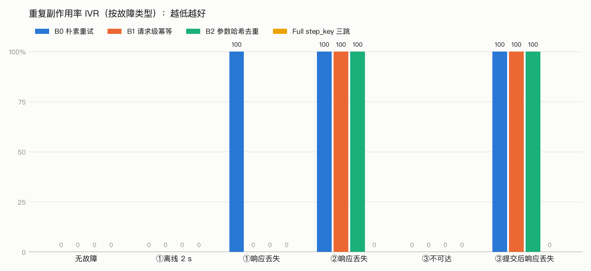

# 对比实验报告：端到端只执行一次

> 由 `eval/report.py` 根据 `eval/results/*.jsonl` 生成。主实验 640 个回合（每个组合重复 10 次），另有参数不变的消融实验。

## 结论

1. **Full 在全部故障回合里没有出现重复副作用**（IVR 0%），B0 / B1 / B2 分别是 50% / 33% / 33%，也没有任何回合丢失副作用。
2. **只保护第①跳不够。** B1（MedTrack 现在的做法）在第①跳响应丢失时没有重复，但在第②跳（100%）和第③跳（100%）照样重复：网关和 Agent 重试时，并不知道上一次其实已经成功了。
3. **按参数哈希去重，在参数会变时失效。** 参数被改写时，B2 和 B1 一样（第②跳 100%）。
4. **就算参数完全不变，B2 也挡不住"已提交但响应丢失"。** 消融实验里 B2 能挡住第②跳（0%），但第③跳仍是 100%：它只在调用**成功之后**才记录，超时那一次没有记录，结果是否已经生效就无从得知。Full 的做法是调用前先写 INTENT，结果不明时按 step_key 去外部系统查询，所以两种情况都能挡住。
5. **排队期间失效的动作**：三个基线把过期的通知和按旧工具版本规划的预约都执行了（各 20/20），Full 全部拦下，交给用户确认；号源被抢时基线只返回报错，Full 会给出可改约的日期；条件变了但仍然有效的动作，Full 没有误拦。
6. **代价**：无故障时 Full 的 P50 延迟比基线多几毫秒，主要来自执行前复核多查了一次号源。

> 每种故障的时序是固定的，所以同一个格子里的结果基本是确定的（要么 0%，要么 100%）。重复 10 次是为了确认结果稳定，置信区间只反映样本量。

## 实验设置

- **系统**：真实的 Compose 服务栈（gateway + agent + Postgres + MySQL），三跳都经过 Toxiproxy。`eval/run_experiment.py` 扮演设备。
- **四个方案**：
  - **B0 朴素重试**：每次重试都换一个新的请求 ID，Agent 每次派发都调用一次工具。
  - **B1 请求级幂等**（MedTrack 现在的做法）：设备持久化请求 ID，第①跳可以重放；Agent 仍然每次派发都调用工具。
  - **B2 参数哈希去重**：在 B1 的基础上，Agent 跳过（工具 + 参数）哈希已经执行过的调用，这是常见 Agent 防重库的做法。
  - **Full**：step_key 贯穿三跳，配合 LangGraph 线程、tool ledger 和执行前复核。
- **故障**：每个回合注入一种（见下表），第一次尝试结束后撤除。用到的超时：设备 3 s，网关→Agent 2 s，Agent→外部系统 1 s。
- **LLM 重新规划**：同一步骤每被派发一次，备注或消息文字就换一种措辞（确定性改写，四个方案完全一样）。这是对"模型超时后重新生成的工具调用和上一次不完全相同"的模拟，**不是真实 LLM**。
- **评判标准**：模拟外部系统按回合 trace 统计实际发生的副作用次数，不采信各个服务自己的上报。
  **IVR** = 出现 ≥2 次副作用的回合 / 总回合（定义参考 idempotencybench），括号内是 Wilson 95% 置信区间。

## 结果一：重复副作用



| 指标 | B0 朴素重试 | B1 请求级幂等 | B2 参数哈希去重 | Full step_key 三跳 |
|---|---|---|---|---|
| 回合数 | 120 | 120 | 120 | 120 |
| **IVR**（出现重复副作用的回合，95% CI） | 50.0% [41.2, 58.8] | 33.3% [25.5, 42.2] | 33.3% [25.5, 42.2] | 0.0% [0.0, 3.1] |
| 多出来的副作用次数 | 60 | 40 | 40 | 0 |
| 正确完成（DONE 且恰好 1 次） | 50.0% | 66.7% | 66.7% | 100.0% |
| 丢失（0 次副作用） | 0.0% | 0.0% | 0.0% | 0.0% |
| 设备提交次数（均值；各方案相同 = 故障条件一致） | 2.00 | 2.00 | 2.00 | 2.00 |

| 故障（跳） | B0 | B1 | B2 | Full |
|---|---|---|---|---|
| 无故障 | 0.0% | 0.0% | 0.0% | 0.0% |
| ①离线 2 s | 0.0% | 0.0% | 0.0% | 0.0% |
| ①响应丢失 | 100.0% | 0.0% | 0.0% | 0.0% |
| ②响应丢失 | 100.0% | 100.0% | 100.0% | 0.0% |
| ③不可达 | 0.0% | 0.0% | 0.0% | 0.0% |
| ③提交后响应丢失 | 100.0% | 100.0% | 100.0% | 0.0% |

## 结果二：排队期间失效的动作

| 场景 | 正确行为 | B0 | B1 | B2 | Full |
|---|---|---|---|---|---|
| slot_taken | 让用户改约 | 执行 0，拦下 0，报错 10 /10 | 执行 0，拦下 0，报错 10 /10 | 执行 0，拦下 0，报错 10 /10 | 执行 0，拦下 10 /10 |
| expired | 不发送，让用户确认 | 执行 10，拦下 0 /10 | 执行 10，拦下 0 /10 | 执行 10，拦下 0 /10 | 执行 0，拦下 10 /10 |
| tool_changed | 不执行，让用户确认 | 执行 10，拦下 0 /10 | 执行 10，拦下 0 /10 | 执行 10，拦下 0 /10 | 执行 0，拦下 10 /10 |
| still_valid | 正常执行（不误拦） | 执行 10/10，误拦 0 | 执行 10/10，误拦 0 | 执行 10/10，误拦 0 | 执行 10/10，误拦 0 |

## 结果三：延迟

设备从第一次提交到拿到最终状态的时间（本机 Docker，含故障注入的等待）。

| 场景 | B0 | B1 | B2 | Full |
|---|---|---|---|---|
| 无故障（P50 / P95） | 26 / 30 ms | 26 / 33 ms | 26 / 55 ms | 32 / 49 ms |
| ③提交后响应丢失（P50 / P95） | 1461 / 1467 ms | 1458 / 1466 ms | 1456 / 1469 ms | 1476 / 1484 ms |

## 消融：重试时参数完全不变

把 Agent 的改写关掉（`MEDSYNC_EXPERIMENT_REPHRASE=0`），只跑故障场景。这一组回答的是：如果重试时参数逐字节相同，B2 够不够用？

| 指标 | B0 朴素重试 | B1 请求级幂等 | B2 参数哈希去重 | Full step_key 三跳 |
|---|---|---|---|---|
| 回合数 | 60 | 60 | 60 | 60 |
| **IVR**（出现重复副作用的回合，95% CI） | 50.0% [37.7, 62.3] | 33.3% [22.7, 45.9] | 16.7% [9.3, 28.0] | 0.0% [0.0, 6.0] |
| 多出来的副作用次数 | 30 | 20 | 10 | 0 |
| 正确完成（DONE 且恰好 1 次） | 50.0% | 66.7% | 83.3% | 100.0% |
| 丢失（0 次副作用） | 0.0% | 0.0% | 0.0% | 0.0% |
| 设备提交次数（均值；各方案相同 = 故障条件一致） | 2.00 | 2.00 | 2.00 | 2.00 |

| 故障（跳） | B0 | B1 | B2 | Full |
|---|---|---|---|---|
| 无故障 | 0.0% | 0.0% | 0.0% | 0.0% |
| ①离线 2 s | 0.0% | 0.0% | 0.0% | 0.0% |
| ①响应丢失 | 100.0% | 0.0% | 0.0% | 0.0% |
| ②响应丢失 | 100.0% | 100.0% | 0.0% | 0.0% |
| ③不可达 | 0.0% | 0.0% | 0.0% | 0.0% |
| ③提交后响应丢失 | 100.0% | 100.0% | 100.0% | 0.0% |

## 局限

- 参数改写是确定性模拟，不是真实模型的输出；真实 LLM 的参数漂移率需要另做实验测量。
- 每回合只注入一种故障，故障时序固定；没有覆盖多种故障叠加、Agent 进程崩溃（tool ledger 租约 30 s）和并发重复提交。
- 外部系统是本机 mock，提供按 step_key 查询的接口；不支持查询的真实系统只能退化为"最多一次 + 人工确认"。
- 延迟在本机 Docker 上测得，绝对值没有参考意义，只用于方案之间对比。

## 复现

```sh
docker compose -f docker-compose.yml -f eval/compose.experiment.yml up -d --build
python3 eval/run_experiment.py --reps 10
MEDSYNC_EXPERIMENT_REPHRASE=0 docker compose -f docker-compose.yml -f eval/compose.experiment.yml up -d agent
python3 eval/run_experiment.py --reps 5 --condition identical --faults-only
uv run --with matplotlib python eval/report.py
```
